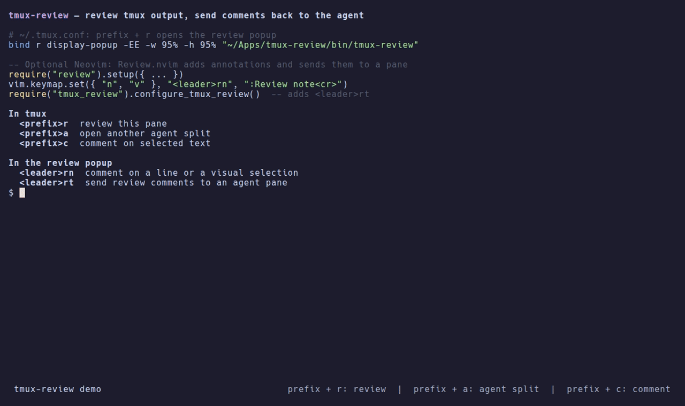

# tmux-review

Annotate tmux output and send your notes to an AI agent, either in the current pane or in a split. Use `<prefix>c` for a quick comment on selected text. Use `<prefix>r` to add comments on several parts of the pane. Start a companion agent with `<prefix>a`; the example commands continue the current agent context when supported.

## Workflows

### Comment on selected tmux text

If you need another agent, press `<prefix>a` first to open it in a side-by-side pane. Then:

1. Enter tmux copy mode and select text.
2. Press `<prefix>c`.
3. Write your note below the quoted text. The selected text is marked with `>`.
4. Save and close the editor.
5. If tmux shows pane numbers, press the destination pane’s number. With one pane, the note returns there automatically.

With one pane in the window, the editor opens in a 40% vertical split and the note returns to that pane. With more panes, the editor opens in a popup and you choose the destination pane after writing the note. The note is not kept as a separate file.

This replaces tmux’s default `prefix c` create-window binding.

### Comment on several sections of a pane

Press `<prefix>r` to open a capture of the current pane in your configured editor. Add comments in the blank area below the instruction at the top. A dashed line separates your comments from the captured pane. After you save and close the editor, tmux sends only the comments above that line to the pane you choose. The captured output stays in the review log for context and is not sent. The log remains under `$XDG_STATE_HOME/tmux-review`, or `~/.local/state/tmux-review` when that variable is unset.

With one pane in the window, comments go back to the current pane. With more panes, choose the destination pane by number. The text is pasted into the agent prompt for you to review and submit.

For structured comments with source paths and quoted excerpts, use the optional Review.nvim integration described below.

## Quick reference

| Action | Keys |
|---|---|
| Start another agent split | `<prefix>a` |
| Comment on selected tmux text | `<prefix>c` |
| Comment on several sections of a pane | `<prefix>r` |

`<prefix>` is the tmux prefix key. `<leader>` is used only by the optional Neovim integration.

## Requirements

- tmux with popup support.
- Bash for the helper scripts. Your interactive shell can be zsh.
- An editor that accepts a file path and waits until you close it. Set `VISUAL` or `EDITOR`; the default is `vi`. You can include space-separated options, such as `code --wait`. Use a wrapper script if an option contains spaces.
- An agent command. By default, `<prefix>a` runs `codex fork --last` when the current pane is running Codex, and `pi --continue` otherwise. Set `@tmux-review-agent-command` to use a different command.

Neovim and Review.nvim are optional. The tmux bindings work without them. Neovim’s ANSI rendering needs `capture-pane -e` support. Git is needed only for Review.nvim’s comment storage; tmux-review initializes its state folder as a local Git repository for that purpose.

## Set up

### With TPM

Add tmux-review to the TPM plugin list in `~/.tmux.conf`. Keep TPM's `run` line at the bottom of the file:

~~~tmux
set -g @plugin 'clobrano/tmux-review'
run '~/.tmux/plugins/tpm/tpm'
~~~

Install it with `<prefix>I`. If TPM is already configured, add only the `@plugin` line and install the plugin.

By default, `<prefix>a` opens an agent split, `<prefix>c` comments on selected text, and `<prefix>r` opens a review. These keys can be changed with `@tmux-review-agent-key`, `@tmux-review-comment-key`, and `@tmux-review-review-key`. Set options before TPM's `run` line or the standalone `run-shell` line. For example:

~~~tmux
# Always run this command in the new agent pane. Arguments are allowed.
set -g @tmux-review-agent-command 'pi --continue'

# Move commenting so <prefix>c keeps tmux's default new-window action.
set -g @tmux-review-comment-key 'C'
~~~

When `@tmux-review-agent-command` is unset, tmux-review keeps the existing behavior: it runs `codex fork --last` when the current pane command is `codex`, and `pi --continue` otherwise. The default `<prefix>c` binding replaces tmux's `new-window` binding. The default `<prefix>r` binding replaces `refresh-client`; change `@tmux-review-review-key` to keep that action.

### Without TPM

Clone the repository and add one line to `~/.tmux.conf`:

~~~sh
git clone https://github.com/clobrano/tmux-review.git ~/Apps/tmux-review
~~~

~~~tmux
run-shell "$HOME/Apps/tmux-review/tmux-review.tmux"
~~~

Reload the configuration:

~~~sh
tmux source-file ~/.tmux.conf
~~~

The editor is selected from `$VISUAL`, then `$EDITOR`, then `vi`. Any executable that accepts a file path can be used. When the selected editor is `nvim`, tmux-review also renders the captured ANSI styles. Other editors receive plain text unless they support ANSI themselves. Neovim opens a read-only capture; use Review.nvim for structured comments, or choose another editor to write plain-text comments in the section at the top.

## ANSI colors in Neovim

When the configured editor is `nvim`, the launcher renders captured ANSI colors in a read-only review buffer. The temporary ANSI capture is removed when Neovim exits. The renderer supports standard and bright colors, 256-color and RGB foreground/background colors, bold, italic, underline, reverse, and strikethrough. Other editors receive plain text unless they support ANSI themselves.

## Optional: Review.nvim annotations

This extension requires Neovim, Review.nvim, and Git. Install this project with lazy.nvim. For a local checkout:

~~~lua
return {
  dir = vim.fn.expand("~/Apps/tmux-review"),
  name = "tmux-review",
  lazy = true,
}
~~~

After publishing the repository, use its GitHub slug instead:

~~~lua
return {
  "clobrano/tmux-review",
  lazy = true,
}
~~~

Run `:Lazy sync` and install Review.nvim separately with your plugin manager. Keep your Review.nvim setup and add this call after `require("review").setup(...)` in its `config` function:

~~~lua
require("tmux_review").configure_tmux_review()
~~~

Set `VISUAL=nvim`, or set `EDITOR=nvim` when `VISUAL` is unset, so the review opens in Neovim. The launcher sets `TMUX_REVIEW_PANE` for the editor. Press `<leader>rt` to send comments with their absolute source paths and quoted excerpts. With one pane in the window, the comments go there directly. With two panes, choose `left` or `right`; `right` is selected by default. With more panes, choose by pane index and running command. Canceling leaves the review open. Neovim closes after a successful paste. The text stays in the agent prompt for you to review and submit. Your existing export key, export callback, and preferences remain in effect.

## Record the demo

The demo GIF is generated with [VHS](https://github.com/charmbracelet/vhs). With `vhs`, `ttyd`, `ffmpeg`, git, tmux and Neovim installed, run from the repository root. Neovim is needed only because this recording shows the optional Review.nvim extension.

~~~sh
./demo/setup.sh   # clones Review.nvim and its dependencies into demo/.plugins
vhs demo/demo.tape
~~~

The tape starts a separate tmux server (`tmux -L tmux-review-demo`) with `demo/tmux.conf`. It shows the setup, runs a fake agent (`demo/fake-agent.sh`), opens another agent split, comments on selected tmux text, opens the review popup, adds two Review.nvim comments and pastes them into the right pane with `<leader>rt`. Neovim uses `demo/config/nvim/init.lua`, which loads Review.nvim and shows the typed keys in a corner window. The tmux status line shows `Ctrl-b` while the prefix is active. Review logs and comments go to temporary directories. The tape writes `demo/tmux-review.gif`.
