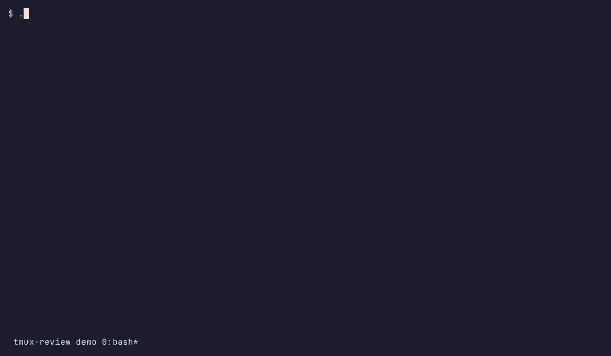

# tmux-review

Review the current tmux pane in Neovim while keeping its ANSI colors and text styles visible. The package captures pane output, writes a plain-text review log, and applies highlights in Neovim.

The package contains:

- `bin/tmux-review`: captures the pane and opens the review buffer.
- `lua/tmux_ansi.lua`: converts ANSI styles into Neovim highlights.

The raw ANSI capture is temporary. The review log contains plain text, so annotation line numbers and exported excerpts stay readable.

## Requirements

- tmux with `capture-pane -e` support
- Bash
- Neovim

The tmux capture and ANSI rendering work without Review.nvim. Review.nvim is optional and adds annotations and comment export.

## Install the Neovim module with lazy.nvim

After publishing the repo, clone it where you want to keep it:

~~~sh
git clone https://github.com/clobrano/tmux-review.git ~/Apps/tmux-review
~~~

Add a plugin spec at `lua/plugins/tmux-review.lua` in your Neovim config.

For a local checkout:

~~~lua
return {
  dir = vim.fn.expand("~/Apps/tmux-review"),
  name = "tmux-review",
  lazy = true,
}
~~~

After publishing the repo, use its GitHub slug instead:

~~~lua
return {
  "clobrano/tmux-review",
  lazy = true,
}
~~~

Then run `:Lazy sync`. Lazy.nvim loads the Lua module when it is required. The tmux launcher also adds its checkout to Neovim's runtime path, so the popup can load the renderer directly.

## Add the tmux binding

Add this to `~/.tmux.conf`, adjusting the path if the repo is elsewhere:

~~~tmux
bind r display-popup -EE -w 95% -h 95% "$HOME/Apps/tmux-review/bin/tmux-review"
~~~

Reload the tmux config, then press the tmux prefix followed by `r`.

The helper stores plain-text review logs under `$XDG_STATE_HOME/tmux-review`, or `~/.local/state/tmux-review` when that variable is unset. It removes the temporary ANSI capture when Neovim exits.

## Optional: add annotations with Review.nvim

Install Review.nvim separately. Keep your existing setup and add this call after `require("review").setup(...)` in its `config` function:

~~~lua
require("tmux_review").configure_tmux_review()
~~~

The launcher sets `TMUX_REVIEW_PANE` while running in the popup. In that popup, press `<leader>rt` to paste the comments into the originating pane and close Neovim. Each comment includes its absolute source path and quoted source excerpt, matching the custom review prompt. The text stays in the agent prompt for you to review and submit. Your existing export key, export callback, and preferences remain in effect.

## Supported ANSI styles

The renderer supports standard and bright colors, 256-color and RGB foreground/background colors, bold, italic, underline, reverse, and strikethrough.

## Record the demo

The demo GIF is generated with [VHS](https://github.com/charmbracelet/vhs). With `vhs`, `ttyd`, `ffmpeg`, git, tmux and Neovim installed, run from the repository root:

~~~sh
./demo/setup.sh   # clones Review.nvim and its dependencies into demo/.plugins
vhs demo/demo.tape
~~~

The tape starts a separate tmux server (`tmux -L tmux-review-demo`) with `demo/tmux.conf`. It shows the setup, runs a fake agent (`demo/fake-agent.sh`), opens the review popup, adds two Review.nvim comments and pastes them into the agent prompt with `<leader>rt`. Neovim uses `demo/config/nvim/init.lua`, which loads Review.nvim and shows the typed keys in a corner window. The tmux status line shows `Ctrl-b` while the prefix is active. Review logs and comments go to temporary directories. The tape writes `demo/tmux-review.gif`.
